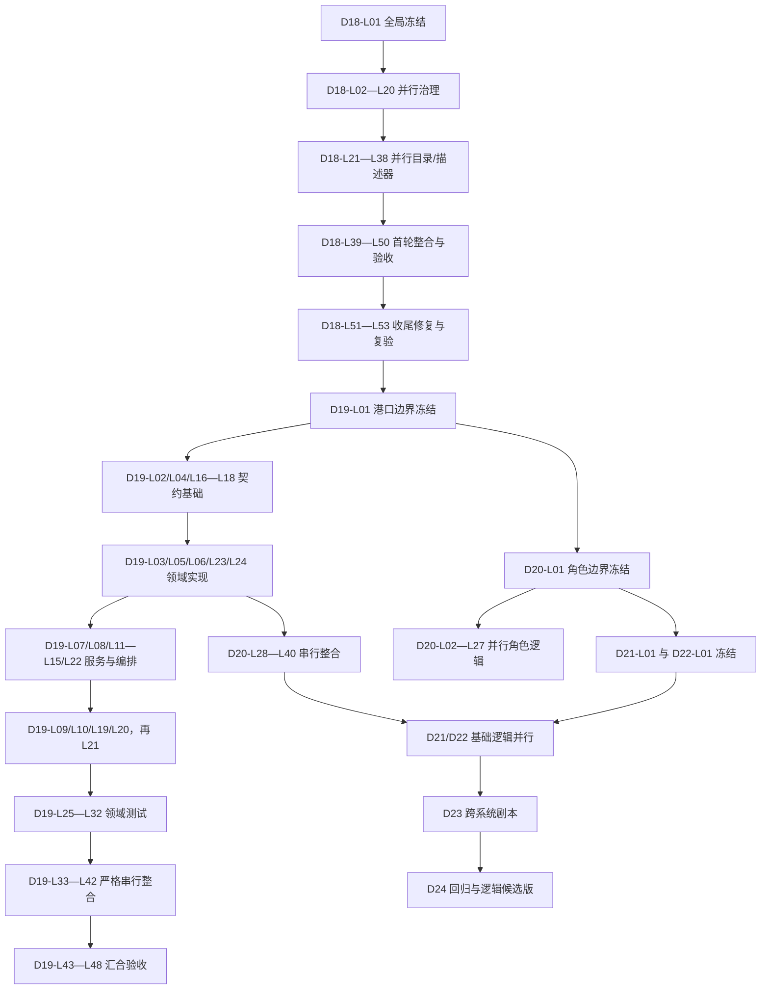

# WhalesIslandReef：D18—D24 逻辑开发任务总索引与执行顺序

> 活跃逻辑路线： [D18—D24 纯逻辑完成路线](D18_D24_VISUAL_PLAYABLE_ROADMAP.md)。
>
> 本文件是 D18—D24 **逻辑任务**编号、依赖和并行顺序入口。实际工作范围在各章节的任务卡中；逻辑状态由 [逻辑任务状态总览](LOGIC_TASK_STATUS.md) 自动汇总。
>
> D16/D17 剩余发布门禁是另一条轨，编号为 `D16-Cxx` / `D17-Cxx`，入口在 [第 9B 章任务卡](AGENT_DEVELOPMENT_CHAPTER_09B_D16_D17_GATES.md) 与 [详细提示词](AGENT_DEVELOPMENT_CHAPTER_09B_D16_D17_GATE_PROMPTS.md)；状态由 [门禁任务状态总览](GATE_TASK_STATUS.md) 汇总。不要把 `GATE_*` 写进本文件的逻辑看板。

## 使用规则

- `P`：同波并行。仅当每项任务的写入范围不同才可同时交给不同 Agent。
- `S`：串行唯一写者。必须在所有前置任务 `LOGIC_PASS` 后开始。
- `G`：汇合门禁。只审计和整合前一波结果，不允许顺手改其他模块。
- 所有任务先是 `PLANNED`；完成后必须写结果 JSON、交接报告和记忆日志，并运行 `python tools/sync_logic_task_status.py`。
- 旧 `D18-Axx`、`D19-Rxx`、`D20-Axx` 不是本索引任务，禁止执行或更新为新状态。

## 章节文件与任务数量

| 章节 | 任务文件 | 编号 | 数量 | 章节产物 |
|---|---|---|---:|---|
| D18 | [任务卡](AGENT_DEVELOPMENT_CHAPTER_10_D18.md) · [详细提示词](AGENT_DEVELOPMENT_CHAPTER_10_D18_PROMPTS.md) | `D18-L01`—`D18-L53` | 53 | 可审计资源/内容逻辑治理（含收尾修复） |
| D19 | [任务卡](AGENT_DEVELOPMENT_CHAPTER_11_D19.md) · [详细提示词](AGENT_DEVELOPMENT_CHAPTER_11_D19_PROMPTS.md) | `D19-L01`—`D19-L48` | 48 | 港口业务与保存闭环逻辑 |
| D20 | [第 12 章](AGENT_DEVELOPMENT_CHAPTER_12_D20.md) | `D20-L01`—`D20-L40` | 40 | 角色、NPC、动物状态与接口逻辑 |
| D21 | [第 13 章](AGENT_DEVELOPMENT_CHAPTER_13_D21.md) | `D21-L01`—`D21-L32` | 32 | 船、天气、海洋与航海逻辑 |
| D22 | [第 14 章](AGENT_DEVELOPMENT_CHAPTER_14_D22.md) | `D22-L01`—`D22-L36` | 36 | UI 命令、焦点和读模型逻辑 |
| D23 | [第 15 章](AGENT_DEVELOPMENT_CHAPTER_15_D23.md) | `D23-L01`—`D23-L38` | 38 | 跨系统确定性完整循环 |
| D24 | [第 16 章](AGENT_DEVELOPMENT_CHAPTER_16_D24.md) | `D24-L01`—`D24-L36` | 36 | 回归、迁移、内容完整性审计 |

独立发布门禁轨（不计入上方逻辑任务数）：

| 章节 | 任务文件 | 编号 | 数量 | 章节产物 |
|---|---|---|---:|---|
| D16 剩余门禁 | [任务卡](AGENT_DEVELOPMENT_CHAPTER_09B_D16_D17_GATES.md) · [详细提示词](AGENT_DEVELOPMENT_CHAPTER_09B_D16_D17_GATE_PROMPTS.md) | `D16-C01`—`D16-C12` | 12 | 合并后：审查/资源/外证/S01/S02；C01—C05 已下发保留 |
| D17 正式切片 | 同上 | `D17-C01`—`D17-C04` | 4 | 合并后正式切片；前置是 `D16-C11 GATE_PASS` |

## 总体波次

## D18：资源与内容逻辑治理（53）

| 波次 | 模式 | 任务 |
|---|---|---|
| 18.0 | S | `D18-L01` |
| 18.1 | P | `D18-L02`—`D18-L20` |
| 18.2A | P（等待 18.1） | `D18-L21`—`D18-L25`、`D18-L29`—`D18-L38` |
| 18.2B | P（等待 D18-L25） | `D18-L26`—`D18-L28` |
| 18.3 | S | `D18-L39`—`D18-L46` |
| 18.4 | G | `D18-L47`—`D18-L50` |
| 18.5 | S（收尾修复） | `D18-L51` → `D18-L52` → `D18-L53` |

## D19：港口业务闭环（48）

| 波次 | 模式 | 任务 |
|---|---|---|
| 19.0 | S（D18-L53 已通过） | `D19-L01` |
| 19.1 | P（契约基础） | `D19-L02`、`D19-L04`、`D19-L16`—`D19-L18` |
| 19.2 | P（领域实现） | `D19-L03`、`D19-L05`、`D19-L06`、`D19-L23`、`D19-L24` |
| 19.3 | P（服务与编排基础） | `D19-L07`、`D19-L08`、`D19-L11`—`D19-L15`、`D19-L22` |
| 19.4 | P（流程、读模型与投影） | `D19-L09`、`D19-L10`、`D19-L19`、`D19-L20` |
| 19.5 | S（迁移） | `D19-L21` |
| 19.6 | P（领域回归） | `D19-L25`—`D19-L32` |
| 19.7 | S（唯一整合写者） | `D19-L33` → `D19-L34` → `D19-L35` → `D19-L36` → `D19-L37` → `D19-L38` → `D19-L39` → `D19-L40` → `D19-L41` → `D19-L42` |
| 19.8 | G（章节门禁） | `D19-L43` → `D19-L44` → `D19-L45` → `D19-L46` → `D19-L47` → `D19-L48` |

## D20：角色、NPC、动物逻辑（40）

| 波次 | 模式 | 任务 |
|---|---|---|
| 20.0 | S（等待 D19-L01） | `D20-L01` |
| 20.1 | P | `D20-L02`—`D20-L15` |
| 20.2 | P | `D20-L16`—`D20-L27` |
| 20.3 | S | `D20-L28`—`D20-L35` |
| 20.4 | G | `D20-L36`—`D20-L40` |

## D21：船、天气、海洋与航海逻辑（32）

| 波次 | 模式 | 任务 |
|---|---|---|
| 21.0 | S（等待 D20-L01） | `D21-L01` |
| 21.1 | P | `D21-L02`—`D21-L14` |
| 21.2 | P | `D21-L15`—`D21-L23` |
| 21.3 | S | `D21-L24`—`D21-L29` |
| 21.4 | G | `D21-L30`—`D21-L32` |

## D22：UI 命令与读模型逻辑（36）

| 波次 | 模式 | 任务 |
|---|---|---|
| 22.0 | S（等待 D20-L01） | `D22-L01` |
| 22.1 | P | `D22-L02`—`D22-L16` |
| 22.2 | P | `D22-L17`—`D22-L25` |
| 22.3 | S | `D22-L26`—`D22-L32` |
| 22.4 | G | `D22-L33`—`D22-L36` |

## D23：跨系统确定性完整循环（38）

| 波次 | 模式 | 任务 |
|---|---|---|
| 23.0 | S | `D23-L01` |
| 23.1 | P | `D23-L02`—`D23-L14` |
| 23.2 | P | `D23-L15`—`D23-L25` |
| 23.3 | S | `D23-L26`—`D23-L34` |
| 23.4 | G | `D23-L35`—`D23-L38` |

## D24：回归、迁移和逻辑候选版（36）

| 波次 | 模式 | 任务 |
|---|---|---|
| 24.0 | S | `D24-L01` |
| 24.1 | P | `D24-L02`—`D24-L14` |
| 24.2 | P | `D24-L15`—`D24-L24` |
| 24.3 | S | `D24-L25`—`D24-L31` |
| 24.4 | G | `D24-L32`—`D24-L36` |

## 开始条件

`D18-L01`—`D18-L53` 已全部 `LOGIC_PASS`；D18-L53-C01 已将 L50 的最终证据与交接统一为当前结论。D19 按 19.1—19.8 波次分派，各任务仍须满足 [D19 详细提示词](AGENT_DEVELOPMENT_CHAPTER_11_D19_PROMPTS.md) 写明的精确前置。旧 D18/D19/D20 的 A/S/R/RERUN 结果永远不能作为新逻辑任务的前置。

D16/D17 剩余门禁从 `D16-C01` 开始，与 D19 逻辑轨并行但不共用状态。D17-C01 必须等待 `D16-C28 GATE_PASS`。
