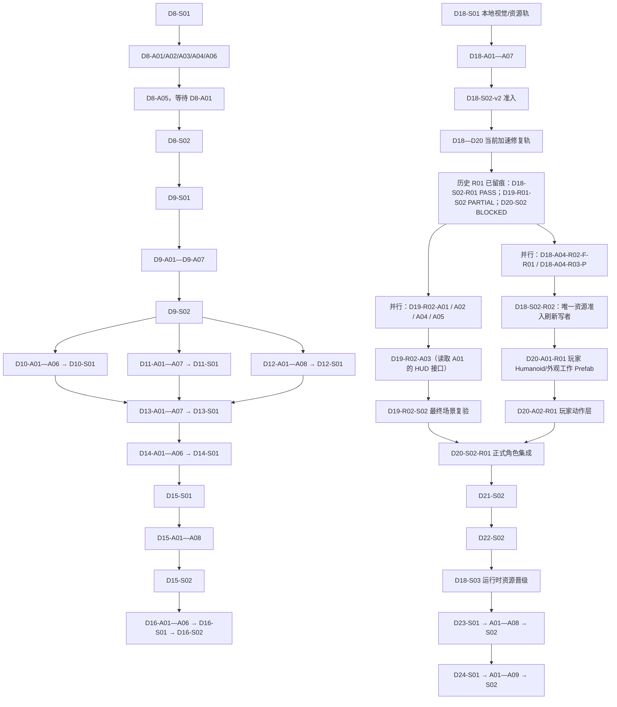

# WhalesIslandReef Agent 开发任务总索引

> 本文件只负责列出开发章节、任务编号、前置依赖和执行顺序。
>
> 本文件不是任务提示词，也不是约束文档。实际交给 Agent 的内容，必须从对应章节文件中复制任务文本块。每个任务文本块都包含自己的项目约束、读取顺序、实现目标、验收标准和结果保存位置。

## 一、使用方式

1. 先在本文件找到当前可执行的“波次”和任务编号；标为“并行”的同一波次可以同时分配。
2. 打开对应章节文件。
3. 展开该任务的“复制给 Agent 的完整提示词”文本块。
4. 将文本块完整复制给一个 Agent；一次只分配一个任务。
5. Agent 完成后，检查该任务规定的主成果文件、交接报告和记忆日志。
6. 同一波次的所有任务完成并满足其汇合门禁后，再分配下一波；不要因为一个任务属于可选内容缺口，就阻塞不依赖它的平行线。

不要把本索引文件本身交给 Agent 代替具体提示词。不要把同一个模块同时分配给多个 Agent。

## 二、开发章节文件

| 开发章节 | 原任务阶段 | 章节提示词文件 | 任务数量 | 章节结果 |
|---|---|---|---:|---|
| 第 1 章 | D8 数据、契约、存档与内容 ID | [01_D8](AGENT_DEVELOPMENT_CHAPTER_01_D8.md) | 8 | 统一实体、契约、存档、事件和内容 ID |
| 第 2 章 | D9 港口—船—近海—船员垂直切片 | [02_D9](AGENT_DEVELOPMENT_CHAPTER_02_D9.md) | 9 | 完成第一条可玩的最小航程 |
| 第 3 章 | D10 船员社会、关系与角色表达 | [03_D10](AGENT_DEVELOPMENT_CHAPTER_03_D10.md) | 7 | 完成角色社会、关系和外观表达 |
| 第 4 章 | D11 海洋采集、生态、珍稀动物与宠物 | [04_D11](AGENT_DEVELOPMENT_CHAPTER_04_D11.md) | 8 | 完成采集、生态、动物和宠物闭环 |
| 第 5 章 | D12 探索、寻宝、部落交易、牌局与收藏 | [05_D12](AGENT_DEVELOPMENT_CHAPTER_05_D12.md) | 9 | 完成探索、社群、牌局和收藏闭环 |
| 第 6 章 | D13 经济、资产、金融、种植与岛屿经营 | [06_D13](AGENT_DEVELOPMENT_CHAPTER_06_D13.md) | 8 | 完成资产、金融、农业和岛屿经营 |
| 第 7 章 | D14 海战、特殊武器、奖励与势力后果 | [07_D14](AGENT_DEVELOPMENT_CHAPTER_07_D14.md) | 7 | 完成战斗、奖励、法律和势力后果 |
| 第 8 章 | D15 批量内容、资产与目录生产 | [08_D15](AGENT_DEVELOPMENT_CHAPTER_08_D15.md) | 10 | 完成批量世界、资产和内容目录 |
| 第 9 章 | D16 性能、迁移、本地化与发布验收 | [09_D16](AGENT_DEVELOPMENT_CHAPTER_09_D16.md) | 8 | 完成完整版本验收和最终交接 |
| 第 10 章 | D18 免费资源、美术标准与导入管线 | [10_D18](AGENT_DEVELOPMENT_CHAPTER_10_D18.md) | 19 | 建立可审计的免费资源库、补齐可导入人形与外观资源、受控准入和运行时晋级管线 |
| 第 11 章 | D19 圣玛格丽特样板岛与港口 | [11_D19](AGENT_DEVELOPMENT_CHAPTER_11_D19.md) | 17 | 修复真实路线、玩家 HUD、港口画面、性能与 PlayMode，再完成正式验收 |
| 第 12 章 | D20 玩家、NPC、动物与动作表现 | [12_D20](AGENT_DEVELOPMENT_CHAPTER_12_D20.md) | 11 | 建立真实 Humanoid 玩家骨架/动作，并正式接入既有 NPC、动物与宠物表现 |
| 第 13 章 | D21 船舶、海洋、天气与航海表现 | [13_D21](AGENT_DEVELOPMENT_CHAPTER_13_D21.md) | 8 | 完成正式起始船、海况、天气和航海反馈 |
| 第 14 章 | D22 UI/UX 全面重构 | [14_D22](AGENT_DEVELOPMENT_CHAPTER_14_D22.md) | 9 | 消除面板堆叠、死按钮和焦点冲突 |
| 第 15 章 | D23 30—45 分钟完整本地可玩闭环 | [15_D23](AGENT_DEVELOPMENT_CHAPTER_15_D23.md) | 10 | 从新游戏连续玩到返港经营并保存继续 |
| 第 16 章 | D24 内容扩量、性能与本地候选版 | [16_D24](AGENT_DEVELOPMENT_CHAPTER_16_D24.md) | 11 | 扩展内容并验收本地可玩候选版 |

合计：159 个任务，其中 34 个 `S` 同步任务、125 个 `A/A*` 异步、资产或串行专项任务。D18—D24 共 85 个任务（含 2026-08-15 的 R01/R02 修复任务）。

> D17 的任务编号和本机垂直切片基线继续保留在 `D17_POST_D16_DEVELOPMENT_PLAN.md`，本索引不重编号、不复制也不改写 D17。用户已明确授权继续本地画面与可玩性开发，因此 D18—D24 可走本地开发轨；它们不替代 D16 未完成的人工、目标设备、跨平台、隐私和发布门禁。

## 三、总执行顺序



当前不是从零开始：`D18-S02-v2`、`D18-S02-R01`、`D19-S01`、`D20-S01` 已通过；`D19-R01-S02=PARTIAL`，`D20-S02=BLOCKED` 是当前真实门禁。不要重跑已经通过的冻结任务，也不要把旧的 `D19-S02`、R01 截图或隔离测试当作正式通过。请以本文件的“当前 D18—D20 R02 执行轨”为准：先并行补齐可导入人形/外观资源，修复 HUD、交互、场景性能和 PlayMode；再刷新唯一准入目录、建立真实玩家 Humanoid/动作；最后先让 D19 通过真实 Player 验收，再做唯一的 D20 正式集成。D21 之后的顺序保持不变。

## 四、逐章任务顺序与编号

### 第 1 章：D8

文件：[AGENT_DEVELOPMENT_CHAPTER_01_D8.md](AGENT_DEVELOPMENT_CHAPTER_01_D8.md)

```text
D8-S01
  ↓
D8-A01、D8-A02、D8-A03、D8-A04、D8-A06
  ↓
D8-A05（必须等待 D8-A01）
  ↓
D8-S02
```

### 第 2 章：D9

文件：[AGENT_DEVELOPMENT_CHAPTER_02_D9.md](AGENT_DEVELOPMENT_CHAPTER_02_D9.md)

```text
D9-S01
  ↓
D9-A01、D9-A02、D9-A03、D9-A04、D9-A05、D9-A06、D9-A07
  ↓
D9-S02
```

### 第 3 章：D10

文件：[AGENT_DEVELOPMENT_CHAPTER_03_D10.md](AGENT_DEVELOPMENT_CHAPTER_03_D10.md)

```text
D9-S02 通过后
  ↓
D10-A01、D10-A02、D10-A03、D10-A04、D10-A05、D10-A06
  ↓
D10-S01
```

### 第 4 章：D11

文件：[AGENT_DEVELOPMENT_CHAPTER_04_D11.md](AGENT_DEVELOPMENT_CHAPTER_04_D11.md)

```text
D9-S02 通过后
  ↓
D11-A01、D11-A02、D11-A03、D11-A04、D11-A05、D11-A06、D11-A07
  ↓
D11-S01
```

### 第 5 章：D12

文件：[AGENT_DEVELOPMENT_CHAPTER_05_D12.md](AGENT_DEVELOPMENT_CHAPTER_05_D12.md)

```text
D9-S02 通过后
  ↓
D12-A01、D12-A02、D12-A03、D12-A04、D12-A05、D12-A06、D12-A07、D12-A08
  ↓
D12-S01
```

### 第 6 章：D13

文件：[AGENT_DEVELOPMENT_CHAPTER_06_D13.md](AGENT_DEVELOPMENT_CHAPTER_06_D13.md)

```text
D10-S01、D11-S01、D12-S01 全部通过后
  ↓
D13-A01、D13-A02、D13-A03、D13-A04、D13-A05、D13-A06、D13-A07
  ↓
D13-S01
```

### 第 7 章：D14

文件：[AGENT_DEVELOPMENT_CHAPTER_07_D14.md](AGENT_DEVELOPMENT_CHAPTER_07_D14.md)

```text
D13-S01 通过后
  ↓
D14-A01、D14-A02、D14-A03、D14-A04、D14-A05、D14-A06
  ↓
D14-S01
```

### 第 8 章：D15

文件：[AGENT_DEVELOPMENT_CHAPTER_08_D15.md](AGENT_DEVELOPMENT_CHAPTER_08_D15.md)

```text
D14-S01 通过后
  ↓
D15-S01
  ↓
D15-A01、D15-A02、D15-A03、D15-A04、D15-A05、D15-A06、D15-A07、D15-A08
  ↓
D15-S02
```

### 第 9 章：D16

文件：[AGENT_DEVELOPMENT_CHAPTER_09_D16.md](AGENT_DEVELOPMENT_CHAPTER_09_D16.md)

```text
D15-S02 通过后
  ↓
D16-A01、D16-A02、D16-A03、D16-A04、D16-A05、D16-A06
  ↓
D16-S01
  ↓
D16-S02
```

### 第 10 章：D18

文件：[AGENT_DEVELOPMENT_CHAPTER_10_D18.md](AGENT_DEVELOPMENT_CHAPTER_10_D18.md)

```text
历史已完成且不重跑：D18-S01、D18-A01—A07、D18-S02-v2、D18-S02-R01
历史 R01 资源任务均已留痕；猫/鹰等准入并不代表玩家 Humanoid 或外观资源已经可用
  ↓
第 1 波（写入目录不同，可并行；若要启动 Unity 导入，只能一项一项独占 Unity）：
D18-A04-R02-F-R01（把女性/中性人形候选做成真实可验证的 Unity Humanoid 导入）
D18-A04-R03-P（补齐真实玩家发型、时代服装的隔离候选与证据）
  ↓（两份交接均存在；允许非核心外观数量仍为 PARTIAL）
D18-S02-R02（唯一写者：刷新 PrefabCandidateIntake，发布本轮 Humanoid/外观消费门禁）
  ↓
为 D20-A01-R01 输出真实 `intake_eligible` 人形/外观条目；不等于 LocalDevelopmentReady
  ↓
后续由 D20 R01 修复线消费；D18-S03 仍等待 D19—D22 正式集成全部通过
```

### 第 11 章：D19

文件：[AGENT_DEVELOPMENT_CHAPTER_11_D19.md](AGENT_DEVELOPMENT_CHAPTER_11_D19.md)

```text
历史已完成：D19-S01、D19-A01—A06；当前 D19-R01-S02 = PARTIAL，不重跑旧 R01 任务
  ↓
第 1 波（写入范围不同；所有启动 Unity/Player 的步骤必须串行独占电脑）：
D19-R02-A01（玩家 HUD、焦点与可见反馈修复）
D19-R02-A02（NPC/登船交互可靠性与失败反馈修复）
D19-R02-A04（唯一 InitialHarbor 画面、性能和固定镜头修复写者）
D19-R02-A05（D19 PlayMode 测试预构建/执行修复）
  ↓（A01 有可读 HUD 接口；A02/A04/A05 已交接）
D19-R02-A03（主菜单、市场、出航、保存/重载路线修复）
  ↓
D19-R02-S02（唯一真实 Player 最终场景复验写者；只有 PASS 才放行 D20-S02-R01）
```

### 第 12 章：D20

文件：[AGENT_DEVELOPMENT_CHAPTER_12_D20.md](AGENT_DEVELOPMENT_CHAPTER_12_D20.md)

```text
历史已完成且不重跑：D20-S01；旧 D20-A01=PARTIAL、A02=BLOCKED，A03—A06 仅有隔离成果，旧 D20-S02=BLOCKED
  ↓（等待 D18-S02-R02 PASS，且 catalog 有经 Unity 验证的人形/外观条目）
D20-A01-R01（唯一玩家视觉工作 Prefab 写者：真 Humanoid/Avatar、锚点、外观与回退）
  ↓（A01-R01 interface 的 `rig_interface_ready=true`）
D20-A02-R01（唯一玩家 Animator/动作表现写者）
  ↓
等待 D19-R02-S02 PASS，且 A03—A06 的既有 P0 tests/interface 与 A01-R01/A02-R01 结果均可读
  ↓
D20-S02-R01（唯一正式玩家/NPC/动物集成与真实 Player 回归写者）
```

### 第 13 章：D21

文件：[AGENT_DEVELOPMENT_CHAPTER_13_D21.md](AGENT_DEVELOPMENT_CHAPTER_13_D21.md)

```text
D18-S02-v2 通过后（受控工作场景/Prefab 制作可与 D19/D20 并行）
  ↓
D21-S01
  ↓
D21-A01、D21-A02、D21-A03、D21-A04、D21-A05、D21-A06
  ↓
等待 D19 当前 PASS（D19-R01-S02）、D20-S02
  ↓
D21-S02（唯一正式船海集成写者）
```

### 第 14 章：D22

文件：[AGENT_DEVELOPMENT_CHAPTER_14_D22.md](AGENT_DEVELOPMENT_CHAPTER_14_D22.md)

```text
D18-S02-v2 通过后（UI 工作场景/Prefab 可与 D19/D20/D21 并行）
  ↓
D22-S01
  ↓
D22-A01、D22-A02、D22-A03、D22-A04、D22-A05、D22-A06、D22-A07
  ↓
等待 D19 当前 PASS（D19-R01-S02）、D20-S02、D21-S02
  ↓
D22-S02（唯一正式主 Canvas/EventSystem 写者）
```

### 第 15 章：D23

文件：[AGENT_DEVELOPMENT_CHAPTER_15_D23.md](AGENT_DEVELOPMENT_CHAPTER_15_D23.md)

```text
D19 当前 PASS（D19-R01-S02）、D20-S02、D21-S02、D22-S02 和 D18-S03 全部通过后
  ↓
D23-S01
  ↓
D23-A01、D23-A02、D23-A03、D23-A04、D23-A05、D23-A06、D23-A07、D23-A08
  ↓
D23-S02（唯一主流程/共享 Bootstrap 写者）
```

### 第 16 章：D24

文件：[AGENT_DEVELOPMENT_CHAPTER_16_D24.md](AGENT_DEVELOPMENT_CHAPTER_16_D24.md)

```text
D23-S02 通过后
  ↓
D24-S01
  ↓
D24-A01（Registry/正式资源唯一写者，必须串行）
  ↓
D24-A02、D24-A03、D24-A04、D24-A05、D24-A06、D24-A07（不同模块，可并行）
  ↓
D24-A08（统一流式与性能集成）
  ↓
D24-A09（真实人工本地 QA；未执行不能假定通过）
  ↓
D24-S02（本地可玩候选版验收，不等于 Steam Ready）
```

## 五、任务类型说明

这些说明只用于索引，不替代任务提示词中的具体约束：

- `S`：同步任务。负责冻结、集成或验收，同一集成边界同时只交给一个 Agent。
- `A`：异步任务。满足前置条件后可以按模块并行，但必须遵守单一写者原则。
- `A*`：异步资产任务。负责模型、数据、音频、文本、目录或占位资源，不得修改强逻辑裁决。

少数 `A` 任务在自身提示词中标注“必须串行”（例如 D24-A01/A08/A09）；该任务必须按提示词执行，不能仅因编号为 `A` 就并行。

## 六、统一结果读取规则

每个章节文件中的每个任务提示词都会明确三类结果位置：

1. **主成果文件**：该任务真正产出的代码、契约、配置或设计登记文件。
2. **任务交接报告**：`docs/game/design/common/handoffs/<章节>/<任务编号>_HANDOFF.md`。
3. **记忆日志**：`.workbuddy/memory/YYYY-MM-DD.md`。

我后续检查任务时，读取以上文件和任务允许目录中的代码、测试结果，不以 Agent 的聊天回复单独作为完成依据。

## 七、旧任务入口

D1—D7 的旧提示词和报告已经归档。D8—D16 与 D18—D24 只能使用本索引和对应章节文件中的任务编号；D17 保留其现有计划和事实，不要从旧 prompts 派生或改写任务。
