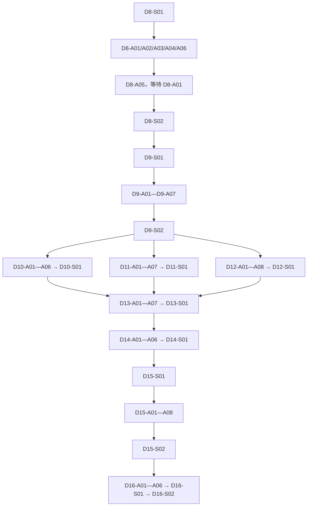

# 《鲸骨航线》Agent 开发任务总索引

> 本文件只负责列出开发章节、任务编号、前置依赖和执行顺序。
>
> 本文件不是任务提示词，也不是约束文档。实际交给 Agent 的内容，必须从对应章节文件中复制任务文本块。每个任务文本块都包含自己的项目约束、读取顺序、实现目标、验收标准和结果保存位置。

## 一、使用方式

1. 先在本文件找到当前可执行的任务编号。
2. 打开对应章节文件。
3. 展开该任务的“复制给 Agent 的完整提示词”文本块。
4. 将文本块完整复制给一个 Agent；一次只分配一个任务。
5. Agent 完成后，检查该任务规定的主成果文件、交接报告和记忆日志。
6. 确认前置任务完成后，再分配下一个任务。

不要把本索引文件本身交给 Agent 代替具体提示词。不要把同一个模块同时分配给多个 Agent。

## 二、开发章节文件

| 开发章节 | 原任务阶段 | 章节提示词文件 | 任务数量 | 章节结果 |
|---|---|---|---:|---|
| 第 1 章 | D8 数据、契约、存档与内容 ID | [01_D8](AGENT_DEVELOPMENT_CHAPTER_01_D8.md) | 8 | 统一实体、契约、存档、事件和内容 ID |
| 第 2 章 | D9 港口—船—近海—船员垂直切片 | [02_D9](AGENT_DEVELOPMENT_CHAPTER_02_D9.md) | 9 | 完成第一条可玩的最小航程 |
| 第 3 章 | D10 船员社会、关系与角色表达 | [03_D10](AGENT_DEVELOPMENT_CHAPTER_03_D10.md) | 7 | 完成角色社会、关系和外观表达 |
| 第 4 章 | D11 海洋采集、生态、珍稀动物与宠物 | [04_D11](AGENT_DEVELOPMENT_CHAPTER_04_D11.md) | 8 | 完成采集、生态、动物和宠物闭环 |
| 第 5 章 | D12 探索、寻宝、部落交易、牌局与收藏 | [05_D12](AGENT_DEVELOPMENT_CHAPTER_05_D12.md) | 9 | 完成探索、社群、牌局和收藏闭环 |
| 第 6 章 | D13 经济、资产、金融、种植与岛屿经营 | [06_D13](AGENT_DEVELOPMENT_CHAPTER_06_D13.md) | 8 | 完成资产、金融、农业和岛屿经营 |
| 第 7 章 | D14 海战、特殊武器、奖励与势力后果 | [07_D14](AGENT_DEVELOPMENT_CHAPTER_07_D14.md) | 7 | 完成战斗、奖励、法律和势力后果 |
| 第 8 章 | D15 批量内容、资产与目录生产 | [08_D15](AGENT_DEVELOPMENT_CHAPTER_08_D15.md) | 10 | 完成批量世界、资产和内容目录 |
| 第 9 章 | D16 性能、迁移、本地化与发布验收 | [09_D16](AGENT_DEVELOPMENT_CHAPTER_09_D16.md) | 9 | 完成完整版本验收和最终交接 |

合计：74 个任务，其中 13 个同步任务、61 个异步或资产任务。

## 三、总执行顺序



## 四、逐章任务顺序与编号

### 第 1 章：D8

文件：[AGENT_DEVELOPMENT_CHAPTER_01_D8.md](AGENT_DEVELOPMENT_CHAPTER_01_D8.md)

```text
D8-S01
  ↓
D8-A01、D8-A02、D8-A03、D8-A04、D8-A06
  ↓
D8-A05（必须等待 D8-A01）
  ↓
D8-S02
```

### 第 2 章：D9

文件：[AGENT_DEVELOPMENT_CHAPTER_02_D9.md](AGENT_DEVELOPMENT_CHAPTER_02_D9.md)

```text
D9-S01
  ↓
D9-A01、D9-A02、D9-A03、D9-A04、D9-A05、D9-A06、D9-A07
  ↓
D9-S02
```

### 第 3 章：D10

文件：[AGENT_DEVELOPMENT_CHAPTER_03_D10.md](AGENT_DEVELOPMENT_CHAPTER_03_D10.md)

```text
D9-S02 通过后
  ↓
D10-A01、D10-A02、D10-A03、D10-A04、D10-A05、D10-A06
  ↓
D10-S01
```

### 第 4 章：D11

文件：[AGENT_DEVELOPMENT_CHAPTER_04_D11.md](AGENT_DEVELOPMENT_CHAPTER_04_D11.md)

```text
D9-S02 通过后
  ↓
D11-A01、D11-A02、D11-A03、D11-A04、D11-A05、D11-A06、D11-A07
  ↓
D11-S01
```

### 第 5 章：D12

文件：[AGENT_DEVELOPMENT_CHAPTER_05_D12.md](AGENT_DEVELOPMENT_CHAPTER_05_D12.md)

```text
D9-S02 通过后
  ↓
D12-A01、D12-A02、D12-A03、D12-A04、D12-A05、D12-A06、D12-A07、D12-A08
  ↓
D12-S01
```

### 第 6 章：D13

文件：[AGENT_DEVELOPMENT_CHAPTER_06_D13.md](AGENT_DEVELOPMENT_CHAPTER_06_D13.md)

```text
D10-S01、D11-S01、D12-S01 全部通过后
  ↓
D13-A01、D13-A02、D13-A03、D13-A04、D13-A05、D13-A06、D13-A07
  ↓
D13-S01
```

### 第 7 章：D14

文件：[AGENT_DEVELOPMENT_CHAPTER_07_D14.md](AGENT_DEVELOPMENT_CHAPTER_07_D14.md)

```text
D13-S01 通过后
  ↓
D14-A01、D14-A02、D14-A03、D14-A04、D14-A05、D14-A06
  ↓
D14-S01
```

### 第 8 章：D15

文件：[AGENT_DEVELOPMENT_CHAPTER_08_D15.md](AGENT_DEVELOPMENT_CHAPTER_08_D15.md)

```text
D14-S01 通过后
  ↓
D15-S01
  ↓
D15-A01、D15-A02、D15-A03、D15-A04、D15-A05、D15-A06、D15-A07、D15-A08
  ↓
D15-S02
```

### 第 9 章：D16

文件：[AGENT_DEVELOPMENT_CHAPTER_09_D16.md](AGENT_DEVELOPMENT_CHAPTER_09_D16.md)

```text
D15-S02 通过后
  ↓
D16-A01、D16-A02、D16-A03、D16-A04、D16-A05、D16-A06
  ↓
D16-S01
  ↓
D16-S02
```

## 五、任务类型说明

这些说明只用于索引，不替代任务提示词中的具体约束：

- `S`：同步任务。负责冻结、集成或验收，同一集成边界同时只交给一个 Agent。
- `A`：异步任务。满足前置条件后可以按模块并行，但必须遵守单一写者原则。
- `A*`：异步资产任务。负责模型、数据、音频、文本、目录或占位资源，不得修改强逻辑裁决。

## 六、统一结果读取规则

每个章节文件中的每个任务提示词都会明确三类结果位置：

1. **主成果文件**：该任务真正产出的代码、契约、配置或设计登记文件。
2. **任务交接报告**：`docs/game/design/common/handoffs/<章节>/<任务编号>_HANDOFF.md`。
3. **记忆日志**：`.workbuddy/memory/YYYY-MM-DD.md`。

我后续检查任务时，读取以上文件和任务允许目录中的代码、测试结果，不以 Agent 的聊天回复单独作为完成依据。

## 七、旧任务入口

D1—D7 的旧提示词和报告已经归档。D8 以后只能使用本索引和对应章节文件中的新任务编号，不要从旧 prompts 派生新任务。
