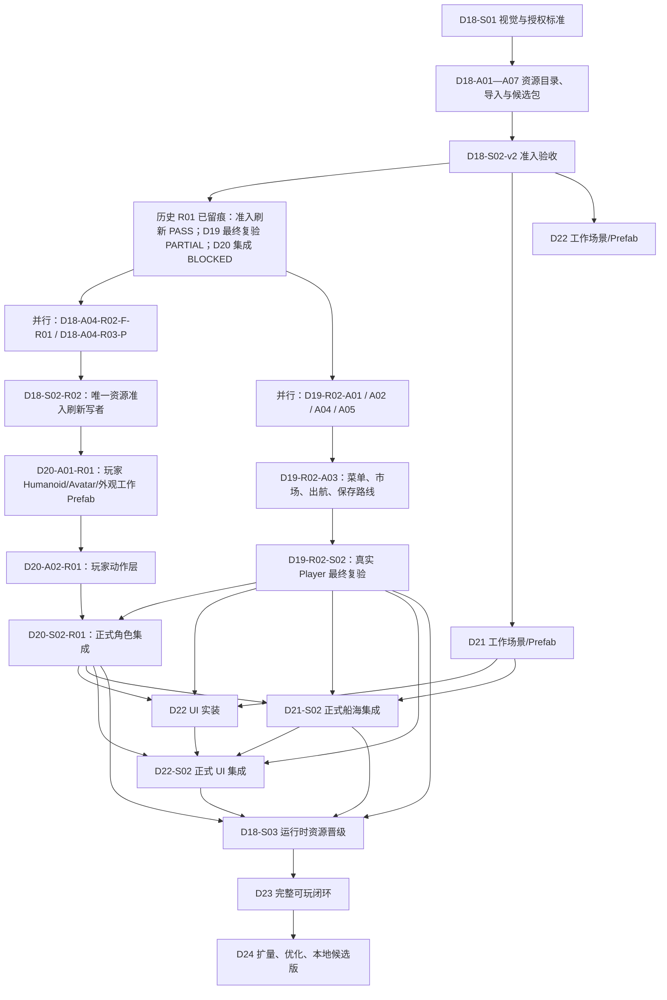

# D18—D24 画面、真实资源与完整本地可玩体验路线

> 状态：2026-08-15 已按当前真实验收结果重排为 D18—D20 R02 修复轨。D21—D24 的目标和门禁不变。
>
> 权威任务入口：`docs/game/AGENT_DEVELOPMENT_TASKS.md`。本文件解释目标、阶段和门禁；真正交给 Agent 的完整提示词位于第 10—16 章文件。

## 1. 这条路线要解决什么

当前项目已经有可运行的系统、数据、存档和本地垂直切片，但玩家看到的仍是开发验证画面：方块岛、占位角色、简单船、调试文字堆叠、UI 层级混乱，以及部分按钮没有明确反馈。

D18—D24 的目标不是继续增加纸面玩法数量，而是把已有系统变成玩家能够看懂、愿意操作、可以连续游玩的一段本地游戏：

- 接入大量来源明确、允许项目使用的免费 3D 模型、材质、动画、UI、音频和环境资源；
- 把圣玛格丽特港从白色方块重建为第一座可展示、可探索、可交互的真实样板岛；
- 让角色、NPC、动物、船舶、海水、天气和灯光拥有一致的视觉风格与实际碰撞；
- 重做 HUD、菜单和交互提示，消除面板堆叠、死按钮、焦点抢占和分辨率错位；
- 打通 30—45 分钟“创建角色 → 港口准备 → 出航 → 探索/采集/贸易/战斗 → 回港经营 → 保存继续”的完整循环；
- 在样板闭环稳定后，再扩展岛屿、植被、动物、建筑和道具数量并做性能优化。

## 2. 本地开发轨与发布门禁

用户已明确要求继续下一目标，因此从本路线生效起：

- D18—D24 的本地资源准备、开发、场景集成和本地验收可以继续执行；
- D16 尚未完成的目标设备、跨平台、真实断电、人工内容审查、授权责任确认、隐私和 Steam 发布证据仍保持独立阻断；
- D18—D24 的 Agent 不得把自动检查替代人工授权决定，不得把候选资源写成“已批准”；
- D24-S02 最多只能给出“本地可玩候选版”结论；D16 外部门禁未全部关闭时，禁止写成“正式发布版”“Steam Ready”或“全部开发完成”。

这意味着项目可以继续变好、继续本机测试，但发布结论仍必须诚实。

## 3. 七个阶段的开发效果

| 章节 | 阶段 | 玩家能看到的结果 | 任务数 |
|---|---|---|---:|
| 第 10 章 | D18 免费资源与美术管线 | 有统一画风、来源清单、许可证、导入规则、可验证的人形/外观补齐、受控准入目录和运行时晋级门禁 | 19 |
| 第 11 章 | D19 样板岛与港口重建 | 圣玛格丽特港拥有可读 HUD、可靠交互、地形/海岸/码头/建筑层次、性能和真实玩家验收 | 17 |
| 第 12 章 | D20 角色、NPC 与动物表现 | 玩家有正式 Humanoid/Avatar 与动作；既有 NPC/动物表现经正式港口集成、回归和 LOD 验收 | 11 |
| 第 13 章 | D21 船舶、海洋与天气 | 船可上下、可驾驶、可停靠；海水、浪花、天气和船体反馈完整 | 8 |
| 第 14 章 | D22 UI/UX 全面重构 | HUD 不堆叠，菜单可读，键鼠/手柄可操作，所有可见按钮都有响应 | 9 |
| 第 15 章 | D23 30—45 分钟完整可玩闭环 | 玩家可以从新游戏连续玩到返港经营并保存，下次继续 | 10 |
| 第 16 章 | D24 内容扩量、性能与本地候选版 | 从一个样板扩展到多岛、多生态、多港口，达到稳定本地试玩质量 | 11 |

新增合计：85 个任务，其中 21 个 `S` 同步任务、64 个 `A/A*` 异步、资产或串行专项任务。

## 4. 为什么必须先做一个样板岛

不能一开始就把 50 座岛、2,000 种植被和 300 种动物全部换成模型。那会同时制造风格不一致、资源重复、授权不清、场景卡顿、碰撞错误和无法验收的问题。

正确顺序是：

```text
资源与授权规则
  → 一座样板岛
  → 角色与船舶
  → UI
  → 一条完整可玩循环
  → 批量扩展与性能优化
```

D19—D23 用圣玛格丽特港和一条代表航线定义质量标准。D24 才允许按这个标准批量扩展。

## 5. 总依赖和并行原则



同一阶段中，标记为 `A` 或 `A*` 的任务只有在写入目录不同、前置任务满足时才可并行。主场景、主 Bootstrap、共享 UI 根节点、共享 Registry 和构建设置始终只有一个同步 Agent 可以修改。

### 5.1 当前 D18—D20 R02 修复执行轨

当前事实不是“所有旧任务都失败”：`D18-S02-v2`、`D18-S02-R01`、`D19-S01` 和 `D20-S01` 已通过。当前真实阻断是：四个女性/中性候选还没有真实 Unity Humanoid/Avatar 证据；D20 玩家仍是 Generic/NoAvatar，因此动作层不能启动；D19 的真实路线、HUD、交互、画面、性能和 PlayMode 仍不满足最终验收。旧 D20-A03—A06 的隔离成果和接口保留，等 D20-S02-R01 正式消费，不重复造轮子。

| 波次 | 可分配任务 | 必须等待什么 | 目的与唯一写者 |
|---|---|---|---|
| 1 | `D18-A04-R02-F-R01`、`D18-A04-R03-P`、`D19-R02-A01`、`D19-R02-A02`、`D19-R02-A04`、`D19-R02-A05` | 无；均先读历史证据 | 分别补真实人形/外观候选，修 HUD/输入反馈，唯一写者重修 InitialHarbor 的画面/性能，并修复 D19 PlayMode 执行链。它们不能互写相同目录。 |
| 2 | `D18-S02-R02`、`D19-R02-A03` | S02-R02 等待两份 D18 R02 交接；A03 等待 A01 的 HUD 接口/交接，且读取 A02 结果 | 一个 Agent 刷新唯一准入目录；另一个只修主菜单—市场—出航—保存/重载路线，不改场景或 HUD 写者文件。 |
| 3 | `D20-A01-R01` | D18-S02-R02 PASS，且 catalog 有真实导入且 Avatar 验证通过的人形条目 | 唯一玩家视觉工作 Prefab 写者建立真实 Humanoid/Avatar、1.80m、锚点、外观和稳定回退；不能改正式场景或生成器。 |
| 4 | `D20-A02-R01`、`D19-R02-S02` | A02-R01 等 A01-R01 的 `rig_interface_ready=true`；D19 最终复验等所有 D19-R02-A01—A05 交接 | 玩家 Animator 在工作范围内完成；D19 唯一最终验收在真实 Player 中重跑全路线、14 镜头、三档性能和 PlayMode。 |
| 5 | `D20-S02-R01` | D19-R02-S02 PASS；A01-R01/A02-R01 的 P0 接口通过；旧 A03—A06 的接口和测试仍可读 | 唯一正式玩家/NPC/动物集成写者，接入既有隔离成果并做真实 Player 回归。 |

这里的 `PASS` 有精确含义：`D18-S02-R02 PASS` 只表示 catalog 刷新真实、可复核；`D19-R02-S02 PASS` 才表示港口的真实玩家门禁关闭；`D20-S02-R01 PASS` 才表示角色表现正式集成通过。任何一项缺少真正 Player、测试或资源证据时，必须如实为 `PARTIAL/BLOCKED`。

### 5.2 并行时不可违反的边界

- 波次 1 的每个 Agent 只能写自己任务编号命名的候选子目录、结果目录、交接和文档；它们都不能改全局准入目录。
- `D18-S02-R02` 是当前唯一可写全局准入目录的 Agent；完成后其余任务只读该目录。
- `D19-R02-A04`、`D19-R02-S02` 与 `D20-S02-R01` 不可并行写 `InitialHarbor`；严格按波次开始，后者开始前前者必须停止。
- `D19-R02-A01` 唯一拥有 HUD 可见性/焦点协调器；`D19-R02-A03` 只能调用它公开的接口，不能回写其目录。D19-R02-A02 只拥有 D2 交互入口，D19-R02-A05 只拥有 D19 测试运行器。
- `D20-A01-R01` 与 `D20-A02-R01` 只拥有玩家工作 Prefab 与动作表现目录；在 `D20-S02-R01` 前不得改正式生成入口或 InitialHarbor。旧 D20-A03—A06 的成果只能读取，不能覆盖。
- D21 及之后仍按原有章节顺序、正式集成门禁和单一写者原则执行，没有被本次加速重排提前放行。

### 5.3 真实运行测试的电脑独占规则

任何任务只要要启动 Unity Editor、Unity Test Runner、Player 窗口、导入模型或采集真实性能，都必须先在聊天中明确通知用户：“本任务需要独占电脑进行 Unity/Player 实测，请保存其他工作并停止使用键盘鼠标；收到允许接管后再开始。”收到允许后，同一时间只能有一个 Agent 启动或操作 Unity/Player；其它独立任务可以只做文档/代码静态准备，但不得同时打开同一项目、抢占窗口或写 Unity Library。

任务结束后 Agent 必须关闭 Player、停止 Play Mode、保存项目内自己的改动，并在交接报告记录“是否实际独占电脑、实际运行了什么、是否由用户中断”。没有获得独占或无法打开真实 Player 时，只能报告静态结果或 `PARTIAL/BLOCKED`，不能声称体验测试通过。

## 6. 免费资源策略

### 6.1 第一批优先来源

| 来源 | 适合内容 | 基线许可策略 | 官方入口 |
|---|---|---|---|
| Kenney | 海盗道具、角色、UI、输入图标 | 优先使用明确标注 CC0 的包 | https://kenney.nl/assets |
| Quaternius | 海盗、自然、角色、动画动物 | 优先使用包页面和包内文件均标注 CC0 的资源 | https://quaternius.com |
| Poly Haven | PBR 材质、HDRI、部分模型 | 仅接入许可证页与单项来源可留痕的 CC0 资源 | https://polyhaven.com/license |
| ambientCG | PBR 材质、地表、岩石、木材 | 仅接入单项页面、下载文件和 CC0 证明完整的资源 | https://ambientcg.com |

首批已知候选包括 Kenney Pirate Kit、Kenney Blocky Characters、Kenney UI Pack、Kenney Input Prompts、Quaternius Pirate Kit、Ultimate Stylized Nature、Ultimate Animated Animal Pack 和 Animated Man Pack。它们仍必须在实际下载当天重新核对官方页面、包内许可证和文件哈希。

### 6.2 禁止的“免费模型”做法

- 不使用从商业游戏、影视、付费包或他人仓库中提取的资源；
- 不把“可以免费下载”自动理解为“允许提交到 Git、修改、打包和商业发行”；
- 不批量导入许可证混杂且无法逐项证明的资源站；
- 不使用带 `NC`（非商业）、来源不明、仅限个人使用或禁止再分发的资源；
- 不伪造作者、许可证、下载日期、原始链接、哈希或人工审核结论；
- 不为了数量把同一个模型的颜色变体登记成大量“独立模型”；
- 不把候选目录中的资源直接标记为正式集成资源。

### 6.3 每个外部资源包必须留下的证据

至少记录：

- `source_id`、包名、作者/组织、官方资源页和直接下载页；
- 下载日期、原始文件名、版本（若有）和 SHA-256；
- 许可证标识、许可证原文或官方快照位置、是否需要署名；
- 是否允许修改、商业发行、在项目仓库保存源文件和随游戏分发；
- 资源类型、实际文件数量、Unity 导入数量、比例/轴向/材质/动画检查；
- 人工审核状态：`Pending`、`Approved` 或 `Rejected`；
- 被哪些 Prefab/场景/内容 ID 使用；未使用时必须保持 candidate 状态。

不确定就保持 `Pending`，不得猜测。

大量二进制资源还必须先确定存储方式：优先使用已确认可用且配额足够的 Git LFS；如果远程 LFS 状态或配额不明确，原始下载包留在被忽略的本地缓存，仓库只保存经过审核、运行时真正需要的优化资源和完整 manifest。任何 Agent 都不得擅自把数 GB 压缩包写进普通 Git 历史，也不得在本任务中迁移既有 Git 历史。

## 7. 资源目录与替换规则

```text
game/Assets/Art/Candidates/<Source>/<Pack>/   候选源文件和包内许可证
game/Assets/Art/Models/<Category>/            审核后正式模型
game/Assets/Art/Textures/                     正式贴图
game/Assets/Art/Materials/                    正式材质
game/Assets/Animations/                       正式动作和控制器
game/Assets/Audio/                            正式音频
game/Assets/UI/                               正式 UI 资源
game/Assets/Prefabs/<Category>/               运行时只引用正式 Prefab
docs/game/design/common/assets/               来源、许可证、清单和替换映射
game/tools/results/<Dxx>/<TASK>/               测试、截图、基准和机器结果
```

场景只能引用 Prefab，不直接引用散落模型。替换资源不能改变 `entity_id`、`content_id`、存档字段、经济公式或系统所有权。

## 8. 统一画面基线

本路线默认采用“一致的风格化低多边形 + 正确比例 + 可信材质与光照”，而不是追求照片级写实。原因是免费资源更容易统一，个人项目更容易达到稳定帧率，也能明显超越当前灰盒效果。

最低视觉基线：

- 1920×1080、16:9 下 HUD 不重叠，关键文字清晰；
- 角色、门、台阶、船舷、码头和建筑比例统一；
- 沙滩、岩地、草地、道路和浅水有可辨识材质过渡；
- 海岸有浅水颜色、浪花或岸线反馈，船有尾流和航行反馈；
- 植被有风动、LOD 和合理生境，不在码头/建筑中穿插；
- 主角有 Idle/Walk/Run/Jump/Interact/Board 等基本动作；
- 昼夜、晴雨、雾和风暴至少有代表性视觉及音频变化；
- 玩家模式默认不显示开发日志、任务阶段标签和自动化状态；
- 所有可见按钮可点击或明确显示“未开放”，不能无反应。

## 9. 性能与规模预算

目标先由 D18-S01 冻结并由 D24 复验，默认建议：

- 推荐配置本地 1080p：平均 60 FPS，1% Low 不低于 45 FPS；
- 质量等级至少有低/中/高三档；
- 主港场景无持续 GC 峰值，无明显重复材质和无限制透明层；
- 角色、动物、植被、建筑和船舶都有 LOD、裁剪或模拟降级方案；
- 首次加载、港口进入、出航、返港和读档都有可测时间预算；
- D24 扩量不得通过删除玩法事实、跳过存档或停止系统裁决换取性能。

## 10. 每个任务的统一完成定义

任务只有满足对应提示词并留下证据才算完成：

1. 只修改任务允许的模块，未覆盖其他 Agent 或用户改动；
2. 代码、Prefab、资源、许可证、文档、测试和截图与任务范围一致；
3. Unity Console 无新增编译错误，相关 EditMode/PlayMode 测试通过；
4. 修改 AgentCore 时通过独立 `dotnet build`；修改 server 时通过 `npm run build` 和相关测试；
5. 所有资源来源可追溯，人工未确认的状态保持 `Pending`；
6. 主成果、机器结果、交接报告和当日记忆日志都存在；
7. 交接报告逐项列出已完成、未完成、风险、验证命令和实际结果；
8. 不能达到验收时写 `BLOCKED` 或 `PARTIAL`，不得用“代码已写”冒充 `PASS`。

## 11. 最终完成效果

D24-S02 通过后，用户应当可以在本机得到以下体验：

1. 从主菜单创建角色并进入不再是方块灰盒的圣玛格丽特港；
2. 看懂 HUD，使用键鼠或手柄完成移动、对话、交易、整理船舱和上下船；
3. 驾船离港，看到海水、风、天气、船帆、尾流和导航反馈；
4. 在近海完成探索、钓鱼/采集、事件或代表性战斗；
5. 回港出售货物、处理船员/资产/经营事项并看到世界后果；
6. 保存、退出、重新启动并继续同一进度；
7. 在至少十次完整循环中没有面板堆叠、必现死按钮、丢档或关键流程卡死；
8. 明确知道哪些内容已达到本地候选质量，哪些仍受 D16 外部门禁或批量内容制作阻断。
